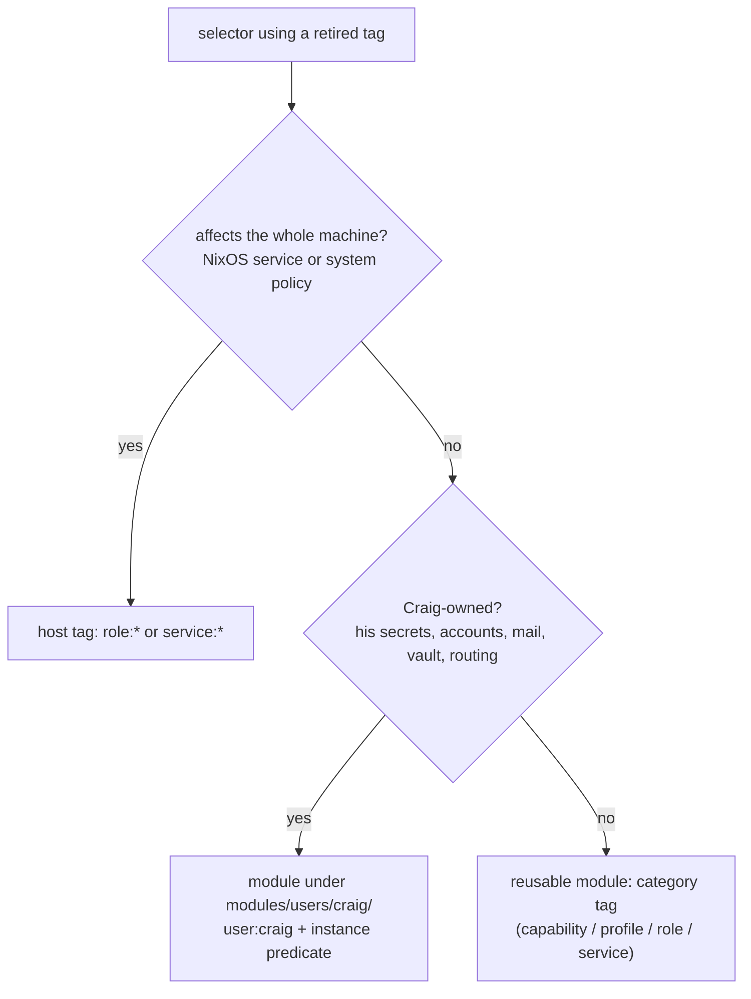

# Design

## Context

See proposal.md for motivation. Four hosts: `blackflame` → `craig@personal`, `unsouled` → `craig@work`, `wintersteel` → `craig@server`, `minimal` → no user.

Verified against `../substrate`:

- `extensions/tags`: `hasTag` and module selection use host tags plus user tags. For a Home Manager evaluation the user part is that user's own tags; for NixOS it is the union of every user on the host. So HM modules *can* see host tags such as `service:cloudflare-warp`, and NixOS modules see every user's tags.
- `settings.tags.selectors`: named `and`/`or`/`not` expressions over tags, usable in module `tags` and `hasTag`, never assignable to hosts or users.
- `core/users.nix`: each user instance has a `profile` field parsed from its name (`craig@work` → `"work"`). `settings.extraArgsGenerators` receive `usercfg`, so a flake can publish a module argument derived from it. Whether that argument reaches HM modules on both the standalone and NixOS-embedded HM paths is **not yet verified**.

Selectors in scope, all three shapes:

1. `tags = [ … "profile:work" … ]` on a module.
2. In-body `hasTag "profile:work"` / `"profile:personal"` (vscodium, herdr app, noctalia, dux, nix autoUpgrade, raeford cifs).
3. External `nix-private/substrate-modules/*` using either form.

## Goals / Non-Goals

**Goals:**
- Zero references to the two tags anywhere the flake evaluates.
- Tags name categories of things; reusable modules carry no identity.
- Same package, service, mount and HM-file sets per host; residual differences explained.

**Non-Goals:**
- Substrate `includes` or any path-based composition. It is rejected outright, including as a pilot or hybrid.
- Per-item tags (`tools:<name>`) and a broad `account:*` family standing in for instance names.
- Retiring `profile:ai`, `profile:programming`, `profile:gaming`, `profile:server`.
- Moving or renaming reusable module paths (Craig-owned blocks move under `modules/users/craig/`).
- Byte-identical toplevel derivations; the set comparison in D5 is the contract.
- Rewriting jj history or archived OpenSpec changes.

## Decisions

### D1. Category tags

Existing categories reused: `profile:programming`, `profile:ai`, `profile:gaming`, `role:workstation`, `role:audio-production`, `capability:filesystem:cifs`. New categories, each justified by what its members are:

| Tag | Scope | Category | Members today |
|---|---|---|---|
| `profile:cloud-infrastructure` | user | operating cloud infrastructure | aws-cli, kube-cli |
| `profile:database-development` | user | developing against MongoDB databases | mongodb (server + shell), mongodb-tools, mongo-orchestration, atlas-cli |
| `profile:continuous-integration` | user | CI system clients | evergreen |
| `profile:jvm-development` | user | JVM IDEs and tooling | idea |
| `profile:team-collaboration` | user | chat, meetings, issue tracking | slack, zoom, jira-cli, slackcli skill (with `profile:ai`) |
| `profile:media` | user | e-books and video library | calibre, freetube |
| `profile:3d-printing` | user | slicing and 3D-printer control | bambu-studio |
| `profile:music-notation` | user | score engraving and notation | lilypond, musescore, debussy (+ skill with `profile:ai`) |
| `role:managed-endpoint` | host | centrally managed device; implies `service:cloudflare-warp` | kolide, osquery, falcon-sensor, code42-aat |
| `service:cloudflare-warp` | host | Zero Trust network client | cloudflare-warp service, shell warp widgets |
| `service:auto-upgrade` | host | unattended system upgrades | nix autoUpgrade |

Why not reuse `role:audio-production` for notation: audio production is recording/mixing; engraving scores is a distinct activity, and a host can have one without the other. Single-member categories (`continuous-integration`, `jvm-development`, `3d-printing`) are named for the activity so later members join without new tags.

### D2. Scope rule



Multi-user boundary: NixOS modules see the union of all users' tags, so NixOS-classed modules require a host tag, never only a user-declared category. Reusable modules never require `user:craig`; Craig-owned modules always do, so another user sharing a host gets categories but none of Craig's configuration. No work/personal alias draws this line.

### D3. Instance predicate for Craig-owned configuration

Craig-owned modules select with `user:craig` and branch on the instance, not a tag. Proposed mechanism, using existing substrate APIs only: a nix-config `settings.extraArgsGenerators` entry publishing the instance profile (`usercfg.profile`, `"work"`/`"personal"`/`"server"`) as a module argument, then `lib.mkIf` on it inside `modules/users/craig/*`.

**Unresolved:** whether that argument is available to HM modules on every path substrate uses (task 2.1 checks). If it is not, implementation stops at that point and reports the gap with options (e.g. an upstream substrate change exposing `usercfg` to class modules); a substitute tag is not introduced. NixOS-scoped Craig settings do not depend on this, because none remain after D4 moves system policy to host tags.

### D4. Migration mapping

| Selector today | Kind | New selector |
|---|---|---|
| programs/aws-cli **(first batch)** | reusable | `profile:cloud-infrastructure` |
| programs/{mongodb, mongodb-tools} **(first batch)** | reusable | `profile:database-development` |
| programs/{mongo-orchestration, atlas-cli} | reusable | `profile:database-development` |
| programs/kube-cli | reusable | `profile:cloud-infrastructure` |
| programs/evergreen | reusable | `profile:continuous-integration` |
| programs/idea | reusable | `profile:jvm-development` |
| programs/{slack, zoom, jira-cli}; skills/slackcli | reusable | `profile:team-collaboration` (skill also `profile:ai`) |
| programs/{calibre, freetube} | reusable | `profile:media` |
| programs/bambu-studio | reusable | `profile:3d-printing` |
| programs/{lilypond, musescore, debussy}; skills/debussy | reusable | `profile:music-notation` (skill also `profile:ai`) |
| services/{kolide, osquery, falcon-sensor, code42-aat} | system policy | host `role:managed-endpoint` |
| services/cloudflare-warp | system policy | host `service:cloudflare-warp` |
| nix autoUpgrade `user:craig && profile:work` | system policy | host `service:auto-upgrade` |
| security/sudo/{work,personal} (identical bodies) | system policy | one module on `role:workstation` |
| noctalia/dux `isWork` warp widgets & package | reusable UI | `hasTag "service:cloudflare-warp"` |
| herdr app, noctalia `isWork` vault path | Craig-owned | reusable modules expose a vault option (default `kb`); Craig module sets `kb-work` on the work instance |
| vscodium `mms` profile | Craig-owned | moved to Craig module, work instance |
| ai/tasks/{day-plan, morning-brief} | Craig-owned | moved under `modules/users/craig/`, work instance, + `profile:ai` |
| users/craig/work (auggie, Atlassian, Glean MCP; Jira secrets) | Craig-owned | stays under `modules/users/craig/`, work instance, MCP block + `profile:ai` |
| users/craig/personal | Craig-owned | stays, personal instance |
| ai/models personal block; craig-work block; models/{grove,fireworks}; opencode/grove-gateway | Craig-owned | moved under `modules/users/craig/`, by instance, + `profile:ai` |
| skills/gws work block; mcp-servers/fastmail-mcp enablement | Craig-owned | moved under `modules/users/craig/`, by instance, + `profile:ai`; reusable parts keep `profile:ai` only |
| mail-filters work / personal | Craig-owned | moved under `modules/users/craig/`, by instance |
| raeford cifs home mount (personal ∨ work) | Craig-owned | existing `user:craig` + `capability:filesystem:cifs` + `location:raeford` gate, no extra predicate |
| raeford cifs media mounts (docker, games, music, photos) | Craig-owned | personal instance |
| nix-private kolide, osquery, code42-aat, cloudflare | system policy | host `role:managed-endpoint` / `service:cloudflare-warp` |
| nix-private aws-cli config, ssh/mongodb, mms-bazel | Craig-owned | `user:craig`, work instance |

The audit (task 1.1) re-runs the search and reconciles every hit with this table before edits.

Resulting tag deltas: `craig@work` drops `profile:work`, gains `profile:cloud-infrastructure`, `profile:database-development`, `profile:continuous-integration`, `profile:jvm-development`, `profile:team-collaboration`. `craig@personal` drops `profile:personal`, gains `profile:media`, `profile:3d-printing`, `profile:music-notation`. `craig@server` unchanged. `unsouled` gains `role:managed-endpoint`, `service:auto-upgrade`.

```mermaid
flowchart LR
  subgraph Host tags
    U[unsouled] --> RME[role:managed-endpoint]
    U --> AU[service:auto-upgrade]
    RME --> WARP[service:cloudflare-warp]
    B[blackflame] --> RW[role:workstation]
    U --> RW
  end
  subgraph "craig@work categories"
    CW[craig@work] --> CI[profile:cloud-infrastructure]
    CW --> DB[profile:database-development]
    CW --> OT["profile:continuous-integration · jvm-development · team-collaboration"]
  end
  subgraph "craig@personal categories"
    CP[craig@personal] --> PM["profile:media · 3d-printing · music-notation"]
  end
  subgraph "modules/users/craig (user:craig + instance)"
    CO["MCP · model routing · mail filters · vault · tasks · media mounts · ssh/aws config"]
  end
  CW -. instance=work .-> CO
  CP -. instance=personal .-> CO
  RME --> S1[kolide · osquery · falcon · code42]
  RW --> SUDO[sudo-rs workstation policy]
  AU --> UP[system.autoUpgrade]
  WARP --> W1[warp service + shell widgets]
```

### D5. Equivalence check

Before any edit, record per host: system package names, systemd service names, `fileSystems` keys, and per-user `home.packages` names and `home.file` keys. Re-evaluate after each batch and diff. Only names and paths are emitted, never option values, so secretspec references and private data are not printed. `nix-private` is covered by evaluating with `--override-input` against the local checkout. Toplevel drv paths are recorded for information only.

### D6. Ordering

Registry additions → instance-predicate check → first batch (cloud-infrastructure, database-development) → host policy → Craig-owned config → remaining categories → `nix-private` → remove the two tags. Old and new tags coexist only between steps; no compatibility alias ships.

## Risks / Trade-offs

- [Instance predicate not reachable with existing substrate APIs] → D3: stop and report; no substitute tag.
- [Category membership is a judgment call (e.g. atlas-cli under database-development vs cloud-infrastructure)] → table is reviewable; moving a member later changes one module's tag.
- [A user-declared category accidentally gates a NixOS module] → D2 rule plus a grep task.
- [`nix-private` edits are in a separate repo] → change both in lockstep and evaluate together before committing either.
- [Merging sudo modules or moving blocks changes merge order] → set diff catches behavioral change; drv-path change alone is acceptable.

## Migration Plan

Each step in D6 is a separate jj change; rollback is `jj abandon` of the offending change. No deploy is required to validate; switching hosts is left to the human.
