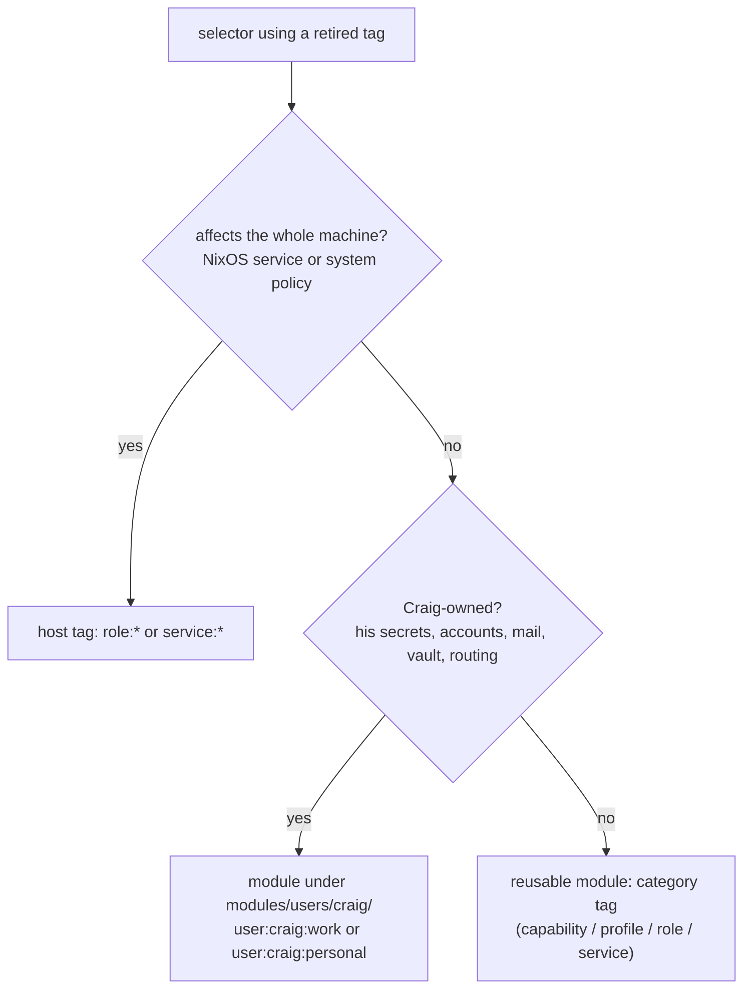

# Design

## Context

See proposal.md for motivation. Four hosts: `blackflame` → `craig@personal`, `unsouled` → `craig@work`, `wintersteel` → `craig@server`, `minimal` → no user.

Verified against `../substrate`:

- `extensions/tags`: `hasTag` and module selection use host tags plus user tags. For a Home Manager evaluation the user part is that user's own tags; for NixOS it is the union of every user on the host. So HM modules *can* see host tags such as `service:cloudflare-warp`, and NixOS modules see every user's tags.
- `settings.tags.selectors`: named `and`/`or`/`not` expressions over tags, usable in module `tags` and `hasTag`, never assignable to hosts or users.
- `core/users.nix`: each user instance is named `user@instance`; this migration no longer exports its parsed `profile` as a custom module argument.

Selectors in scope, all three shapes:

1. `tags = [ … "profile:work" … ]` on a module.
2. In-body `hasTag "profile:work"` / `"profile:personal"` (vscodium, herdr app, noctalia, dux, nix autoUpgrade, raeford cifs).
3. External `nix-private/substrate-modules/*` using either form.

## Goals / Non-Goals

**Goals:**
- Zero references to the two tags anywhere the flake evaluates.
- Tags name categories of things; reusable modules carry no identity.
- Same package, service, mount and HM-file sets per host; residual differences explained.

**Non-Goals:**
- Using Substrate `includes` for this migration. The combined finder is a union: included modules are selected even when their tags do not match, and the tag finder selects untagged modules generally. It cannot narrow selection to one user instance while preserving category-tag prerequisites.
- Per-item tags (`tools:<name>`) and a broad `account:*` family standing in for instance names.
- Retiring `profile:ai`, `profile:programming`, `profile:gaming`, `profile:server`.
- Moving or renaming reusable module paths (Craig-owned blocks move under `modules/users/craig/`).
- Byte-identical toplevel derivations; the set comparison in D5 is the contract.
- Rewriting jj history or archived OpenSpec changes.
- Fixing pre-existing NixOS-surface modules selected only by user-declared tags (gamemode, steam, zsh, nh, dux/noctalia, hyprland/niri). These predate this change, work on today's single-user hosts, and need a host-role migration of their own; recorded as a follow-up change if multi-user hosts ever matter.

## Decisions

### D1. Category tags

Existing categories reused: `profile:programming`, `profile:ai`, `profile:gaming`, `role:workstation`, `role:audio-production`, `capability:filesystem:cifs`. New categories, each justified by what its members are:

| Tag | Scope | Category | Members today |
|---|---|---|---|
| `profile:cloud-infrastructure` | user | operating cloud infrastructure | aws-cli, kube-cli |
| `profile:database-development` | user | developing against MongoDB databases | mongodb (server + shell), mongodb-tools, mongo-orchestration, atlas-cli |
| `profile:email-management` | user | managing email accounts, aliases, and filtering | maskedemail wrapper/helper, Fastmail MCP, Craig work/personal mail filters |
| `profile:jvm-development` | user | JVM IDEs and tooling | idea |
| `profile:team-collaboration` | user | chat, meetings, issue tracking | slack, zoom, jira-cli, slackcli skill (with `profile:ai`) |
| `profile:media` | user | e-books and video library | calibre, freetube |
| `profile:3d-printing` | user | slicing and 3D-printer control | bambu-studio |
| `profile:music-notation` | user | score engraving and notation | lilypond, musescore, debussy (+ skill with `profile:ai`) |
| `role:managed-endpoint` | host | centrally managed device; implies `service:cloudflare-warp` | kolide, osquery, falcon-sensor, code42-aat |
| `service:cloudflare-warp` | host | Zero Trust network client | cloudflare-warp service, shell warp widgets |
| `service:auto-upgrade` | host | unattended system upgrades | nix autoUpgrade |
| `role:server` | host | server-grade local policy | sudo server policy on `wintersteel` |

Craig instance selectors are a separate, deliberately narrow identity layer, not reusable categories:

| Tag | Scope | Purpose | Applied to |
|---|---|---|---|
| `user:craig:work` | Craig user instance | Select Craig-owned work settings | `craig@work` and Craig-owned work Home Manager modules only |
| `user:craig:personal` | Craig user instance | Select Craig-owned personal settings | `craig@personal` and Craig-owned personal Home Manager modules only |

The hierarchical tags imply the parent `user:craig` tag. Common Craig modules continue using `user:craig`; reusable program/service modules never use the instance leaves.

Why not reuse `role:audio-production` for notation: audio production is recording/mixing; engraving scores is a distinct activity, and a host can have one without the other. Single-member categories (`jvm-development`, `3d-printing`) are named for the activity so later members join without new tags.

### D2. Scope rule



Multi-user boundary: NixOS modules see the union of all users' tags, so system policy requires host tags. Instance-leaf tags are limited to Home Manager-only Craig settings, with one explicit exception: `users/craig/personal/cifs.nix` selects its NixOS location mounts with `user:craig:personal` plus `location:raeford` and `capability:filesystem:cifs`. No other leaf-bearing module may add `nixos` or `generic` fragments. Reusable modules never require `user:craig` or an instance leaf, so another user sharing a host gets category-selected tools but none of Craig's account configuration.

### D3. Instance tags for Craig-owned configuration

Register `user:craig:work` and `user:craig:personal`, then put the matching leaf on the corresponding Craig user instance. Apply the same leaf to its Craig-owned Home Manager modules, retaining any category prerequisites (`profile:ai`, `profile:programming`, secrets) as conjunctive tags. Common Craig settings remain selected by `user:craig`. Remove the `extraArgsGenerators` entry and all `instanceProfile` branches. Do not apply a leaf to reusable modules or system-wide policy. The sole NixOS exception is the personal CIFS media-mount module, where the personal leaf is conjunctive with the Raeford location and CIFS capability rather than a custom host-user predicate.

### D4. Migration mapping

| Selector today | Kind | New selector |
|---|---|---|
| programs/aws-cli **(first batch)** | reusable | `profile:cloud-infrastructure` |
| programs/{mongodb, mongodb-tools} **(first batch)** | reusable | `profile:database-development` |
| programs/{mongo-orchestration, atlas-cli} | reusable | `profile:database-development` |
| programs/kube-cli | reusable | `profile:cloud-infrastructure` |
| programs/evergreen | split | generic package and its option use `profile:programming`; Craig's wrapper uses `user:craig:work` + secrets + programming. Craig personal receives the generic package without work credentials |
| programs/idea | reusable | `profile:jvm-development` |
| programs/{slack, zoom}; skills/slackcli | reusable | `profile:team-collaboration` (skill also `profile:ai`) |
| programs/jira-cli | split | package on `profile:team-collaboration`; `JIRA_ACCESS_TOKEN` wiring and MongoDB-specific account configuration move under `modules/users/craig/work` |
| programs/{calibre, freetube} | reusable | `profile:media` |
| programs/bambu-studio | reusable | `profile:3d-printing` |
| programs/{lilypond, musescore, debussy}; skills/debussy | reusable | `profile:music-notation` (skill also `profile:ai`) |
| services/{kolide, osquery, falcon-sensor, code42-aat} | system policy | host `role:managed-endpoint` |
| services/cloudflare-warp | system policy | host `service:cloudflare-warp` |
| nix autoUpgrade `user:craig && profile:work` | system policy | host `service:auto-upgrade` |
| security/sudo/{work,personal} (identical bodies) | system policy | one module on `role:workstation` |
| noctalia/dux `isWork` warp widgets & package | reusable UI | `hasTag "service:cloudflare-warp"` |
| herdr app, noctalia `isWork` vault path | Craig-owned | reusable modules expose a vault option (default `kb`); Craig work module sets `kb-work` under `user:craig:work` |
| vscodium `mms` profile | Craig-owned | selected under `user:craig:work` |
| ai/tasks/{day-plan, morning-brief} | Craig-owned | selected under `user:craig:work` + `profile:ai` |
| users/craig/work (auggie, Atlassian, Glean MCP; Jira secrets) | Craig-owned | `user:craig:work` + `core:security:secrets`; its AI-only block remains guarded by `profile:ai` |
| users/craig/personal | Craig-owned | `user:craig:personal`; sync settings stay in `personal/default.nix`, while Home Assistant MCP moves to `personal/ai.nix` on `user:craig:personal` + `profile:ai` |
| ai/models personal block; craig-work block; models/{grove,fireworks}; opencode/grove-gateway | Craig-owned | personal/work variants use matching leaf + `profile:ai` |
| skills/gws work block; mcp-servers/fastmail-mcp enablement | Craig-owned | GWS uses `user:craig:work` + `profile:ai`; Fastmail MCP uses `user:craig:personal` + `profile:ai` + `profile:email-management`; reusable parts keep `profile:ai` only |
| mail-filters work / personal | Craig-owned | matching work/personal leaf tags + `profile:email-management` |
| raeford cifs home mount (personal ∨ work) | Craig-owned | existing `user:craig` + `capability:filesystem:cifs` + `location:raeford` gate, no extra predicate |
| raeford cifs media mounts (docker, games, music, photos) | Craig-owned NixOS exception | `user:craig:personal` + `location:raeford` + `capability:filesystem:cifs`; no `hostcfg.users` guard |
| nix-private kolide, osquery, code42-aat, cloudflare | system policy | host `role:managed-endpoint` / `service:cloudflare-warp` |
| nix-private aws-cli config, ssh/mongodb, mms-bazel | Craig-owned | `user:craig:work` plus existing programming/SSH/secrets requirements |
| programs/maskedemail | split | generic wrapper/helper on `profile:email-management` with an optional `tokenFile`; Fastmail reference and token path move to `modules/users/craig/personal/maskedemail.nix` on `user:craig:personal` + secrets + category. Work receives the generic unwrapped CLI/helper without the Fastmail entry |
| programs/herdr/core | Craig-owned | moves under `modules/users/craig/` (all instances), keeping `user:craig` + existing tags, HM service and NixOS linger unchanged |
| locations/raeford/secrets | location-owned | stays in `locations/raeford/`; location + capability + `user:craig` gate is the documented form for location-scoped account wiring |
| security/sudo/server.nix | system policy | host `role:server` on `wintersteel` (mirrors `role:workstation`); no longer selected by user `profile:server` |

The audit (task 1.1) re-runs the search and reconciles every hit with this table before edits.

Resulting tag deltas: `craig@work` drops `profile:work`, gains `user:craig:work` and its functional categories (`profile:cloud-infrastructure`, `profile:database-development`, `profile:email-management`, `profile:jvm-development`, `profile:team-collaboration`). `craig@personal` drops `profile:personal`, gains `user:craig:personal` and its functional categories (`profile:email-management`, `profile:media`, `profile:3d-printing`, `profile:music-notation`). `craig@server` unchanged. `unsouled` gains `role:managed-endpoint`, `service:auto-upgrade`.

```mermaid
flowchart LR
  subgraph Host tags
    U[unsouled] --> RME[role:managed-endpoint]
    U --> AU[service:auto-upgrade]
    RME --> WARP[service:cloudflare-warp]
    B[blackflame] --> RW[role:workstation]
    U --> RW
  end
  subgraph "craig@work categories"
    CW[craig@work] --> CI[profile:cloud-infrastructure]
    CW --> DB[profile:database-development]
    CW --> OT["profile:jvm-development · team-collaboration"]
  end
  subgraph "craig@personal categories"
    CP[craig@personal] --> PM["profile:media · 3d-printing · music-notation"]
  end
  subgraph "Craig-owned settings"
    CWCFG["user:craig:work<br/>MCP · models · mail · vault · tasks · SSH/AWS"]
    CPCFG["user:craig:personal<br/>mail · vault · media settings"]
  end
  CW --> CWCFG
  CP --> CPCFG
  RME --> S1[kolide · osquery · falcon · code42]
  RW --> SUDO[sudo-rs workstation policy]
  AU --> UP[system.autoUpgrade]
  WARP --> W1[warp service + shell widgets]
```

### D5. Equivalence check

Before any edit, record per host: system package names, systemd service names, `fileSystems` keys, and per-user `home.packages` names and `home.file` keys. Re-evaluate after each batch and diff. Only names and paths are emitted, never option values, so secretspec references and private data are not printed. During development, evaluate `nix-private` with `--override-input` against the local checkout. The root lockfile now pins the published migrated private revision; the default input path was verified without an override, and the resulting `unsouled` build matches the local-checkout build. Toplevel drv paths are recorded for information only.

Intentional residual differences: `unsouled` replaces `maskedemail-cli-wrapped` with the generic unwrapped `maskedemail-cli` and keeps `maskedemail-new`, because only Craig personal supplies the Fastmail token; `blackflame` gains the generic `evergreen` package without work credential entries, because generic Evergreen is selected by `profile:programming`. Comparisons use the same local Substrate override on both sides; the local Substrate's untagged-module behavior otherwise introduces an unrelated `micro`/`nano` delta against the original locked-input baseline.

### D6. Ordering

Register identity leaves and functional categories → retag reusable modules → migrate host policy → migrate Craig-owned Home Manager configuration to identity leaves → migrate `nix-private` → remove the two context tags → refresh the private lock after publication. Old and new tags coexist only between steps; no compatibility alias ships.

### D7. Architecture-limited final build

The three x86_64 host toplevels build successfully on the current machine. `wintersteel` evaluates to an aarch64-linux toplevel derivation, but cannot be built here: Nix is running on x86_64-linux with no AArch64 platform support, emulation, or configured remote builder. Treat this as an environment-limited build, not a successful AArch64 build; run the toplevel build on an AArch64-capable builder before deployment.

## Risks / Trade-offs

- [A work/personal identity tag accidentally reaches a reusable or NixOS-scoped module] → D2 confines leaves to Craig-owned Home Manager modules except the documented personal CIFS location mount; audit module classes and user isolation.
- [Removing the custom argument misses an `instanceProfile` branch] → grep all nix-config and nix-private consumers, then evaluate work/personal/server fixtures.
- [Category membership is a judgment call (e.g. atlas-cli under database-development vs cloud-infrastructure)] → table is reviewable; moving a member later changes one module's tag.
- [A user-declared category accidentally gates a NixOS module] → D2 rule plus a grep task.
- [`nix-private` edits are in a separate repo] → change both in lockstep and evaluate together before committing either.
- [Merging sudo modules or moving blocks changes merge order] → set diff catches behavioral change; drv-path change alone is acceptable.

## Migration Plan

Each step in D6 is a separate jj change; rollback is `jj abandon` of the offending change. No deploy is required to validate; switching hosts is left to the human.
